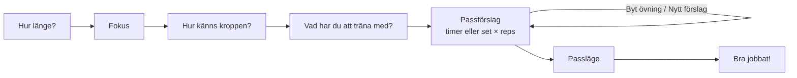

# BDY Day

En träningsapp för kroppsviktsträning. Den ligger på [stefaneklund.se/bdyday](https://stefaneklund.se/bdyday).

Idén är **"Vad vill du träna idag?"**: man svarar på några snabba frågor och får ett färdigt pass med bara kroppsvikt. Varje övning visas som en animerad figur. Appen är gratis, kräver inget konto och sparar all data i telefonen. Den går att installera på hemskärmen (PWA).

> **Håll den här filen aktuell.** Den beskriver hur appen fungerar *nu*. Ändras beteendet, datamodellen eller övningsbiblioteket ska filen uppdateras i samma commit (se `AGENTS.md` i repots rot). Exakta fält och typer finns i [`_lib/types.ts`](_lib/types.ts).

## Status

Version 1 byggs i steg. Det som finns nu:

- **Startsidan** (`/bdyday`): rubriken, streak och veckomål (fortfarande 0, eftersom pass inte loggas än) och knappen *Träna*.
- **Träna** (`/bdyday/trana`): fyra frågor, ett passförslag och passläget (se *Passflödet* nedan).
- **Övningsbiblioteket** (`/bdyday/ovningar`): alla övningar med animerade figurer, filter per fokus och ett blad med instruktion och länkar till lättare och svårare varianter.
- **PWA**: manifest och ikoner. Appen kan läggas till på hemskärmen.

Kvar till v1: loggning av reps efter passet, progression, historik och inställningar.

## Sidor

| Adress | Vad | Fil |
|---|---|---|
| `/bdyday` | Startsidan "Idag" | `page.tsx` → `_components/home.tsx` |
| `/bdyday/trana` | Frågor → passförslag → passläge | `trana/page.tsx` → `_components/train.tsx`, `_components/player.tsx` |
| `/bdyday/ovningar` | Övningsbiblioteket | `ovningar/page.tsx` → `_components/library.tsx` |
| `/bdyday/manifest.webmanifest` | PWA-manifestet | `public/bdyday/manifest.webmanifest` |
| `/bdyday/pwa-icon/192`, `/512` | Appikoner till manifestet | `pwa-icon/[size]/route.tsx` |
| `/bdyday/apple-icon` | Ikon för iPhone-hemskärmen | `apple-icon.tsx` |

BDY Day har en **egen root-layout** (`layout.tsx`, `bdyday.css`), precis som Whenworks. Huvudsajtens stil påverkar den alltså inte.

## Passflödet

Allt sker på en sida och i minnet, så inget behöver sparas. Logiken finns i [`_lib/plan.ts`](_lib/plan.ts).

**Frågorna** (ett tryck per fråga):
- **Tid:** 5, 10, 15 eller 20 min.
- **Fokus:** helkropp, ben, överkropp, core, explosivt eller löparstyrka.
- **Hur kroppen känns:**
  - *Trött* ger lättare varianter, inga hopp (utom vid fokus explosivt) och färre set.
  - *Som vanligt* ger nivå 2.
  - *Pigg* ger svårare varianter.
- **Utrustning:** bara golvet, räck/gren, trappa/kant eller båda. Styr vilka övningar som får vara med.

**Generatorn** rangordnar övningarna:
1. En övning per familj, den nivå som ligger närmast dagens energi. En hoppvariant räknas som ett steg svårare om fokus inte är explosivt.
2. Övningarna blandas så att samma kroppsdel inte kommer två gånger i rad (ben, överkropp, core, explosivt).
3. Hopp begränsas till ungefär var fjärde övning (var tredje om man är pigg). Undantaget är fokus explosivt.
4. Överkropp har få familjer och fylls ut med core, efter varannan överkroppsövning.
5. Sist i listan kommer familjernas andra varianter, som reserver för *Byt*.

**Två lägen.** Man kan alltid välja läge, och båda har ett förval som räknas fram från svaren:

| | Timer | Set × reps |
|---|---|---|
| Hur | Fast arbetstid och vila per övning | Gör dina reps i egen takt, tryck *Klart*. Vilan räknas ner. |
| Förval | 40/20 (val: 30/30, 45/15) | Trött 2 set / 60 s vila, som vanligt 3 / 45 s, pigg 3 / 30 s (val: 2–5 set, 30–90 s vila) |
| Antal övningar | Så många som ryms i tiden. Räcker inte listan blir det flera varv. | Så många som ryms enligt en uppskattning av tid per rep, minst tre |
| Förvalt för | allt utom löparstyrka | löparstyrka (Runner's World: 3–4 × 10, 30–60 s vila) |

- Övningar *per sida* får ett block per sida i timerläget. I setläget står reps per sida.
- Hålltider (plankor, häng) räknas ner även i setläget.
- Antal reps per övning i setläget finns i `DOSE` i `plan.ts`. Standard är 10 reps eller 30 s, men till exempel knäböjshopp har 4 och snabba tåhävningar 40, som i artikeln.

**Passförslaget** visar övningarna med reps eller tid. *Byt* (↻) byter en övning mot en oanvänd, helst för samma kroppsdel och från en annan familj. *Nytt förslag* blandar om. *Uppvärmning* (cirka 3 min, 30 s per rörelse) kan slås på och väljs efter fokus.

**Passläget:**
- Börjar med *Gör dig redo* (5 s).
- Under arbetet visas figuren, instruktionen och nedräkningen eller antal reps.
- Under vilan visas *Nästa* övning. Mellan sidorna står det *Byt sida*.
- Pip de sista 3 sekunderna och vid start, och telefonen vibrerar vid varje byte.
- Skärmen hålls tänd (Wake Lock), där webbläsaren stöder det.
- Den andra sidan av en ensidig övning visas spegelvänd.
- Man kan pausa, hoppa fram och tillbaka och avsluta.
- Timern räknar mot klockan, så den drar inte iväg.

## Utseende

Mörkt och sportigt: nästan svart bakgrund och **Hammarbygrönt** (`#00A651`) som accent. Rubrikerna använder *Barlow Condensed* (kursiv, versaler) och brödtexten *Inter*. Färgerna är variabler överst i `bdyday.css`.

## Språk

Svenska och engelska. Ett sparat val vinner, annars följer appen webbläsaren (svenska för `sv-*`, engelska för allt annat). Valet sparas i `localStorage` (`bdy_lang`). Gränssnittets texter finns i `_lib/i18n.ts`, och övningarnas namn och instruktioner finns i `_lib/exercises.ts`.

## Övningsbiblioteket

Alla övningar finns i [`_lib/exercises.ts`](_lib/exercises.ts). Varje övning har:

- **Familj och nivå (1–3).** Övningar i samma familj är lättare och svårare varianter av samma rörelse, till exempel *armhävning på knä → armhävning → triangelarmhävning*. Progressionen kommer att flytta upp och ner inom en familj.
- **Fokus.** Ben, överkropp, core, explosivt och löparstyrka. En övning kan ha flera. "Helkropp" är inget fokus på en övning utan en blandning i passet.
- **Roll.** Antingen en vanlig övning eller en *uppvärmningsövning*, som bara används i det valfria uppvärmningsblocket.
- **Mått.** Reps eller hålltid (plankor, häng).
- **Sidor.** Symmetrisk, växla sida, eller *per sida* (till exempel sidoplanka och enbensknäböj), som ger ett block per sida i passet.
- **Kräver.** Det mesta görs på golvet. Några övningar kräver en **räck/gren** eller en **trappa/kant**. Platsfrågan i passet styr om de får vara med.
- **Tempo.** *Långsamt* (löparstyrka) eller *explosivt* (hopp). Det visas som en hint och styr animationens takt.

Källor:
- Grundpasset kommer från Outside Online, *The 15-Minute Bodyweight Workout You Can Do Anywhere*: 15 övningar, 40 s arbete och 20 s vila.
- Löparstyrkan kommer från Runner's World, *Så kan du minska skaderisken som veteranlöpare* (Jimmy Englund, fysioterapeut). Därifrån är bara övningarna för kroppsvikt med (steg 1 och hoppen i steg 3). Steg 2 med vikter är utelämnat.
- Resten (`source: 'bdy'`) är vanliga basövningar som fyller ut familjerna med lättare och svårare varianter.

Ett nytt fokus eller en ny övning läggs till i `exercises.ts`. Biblioteket och filtren uppdateras då automatiskt.

## Figurerna

Figurerna är **SVG-streckgubbar som ritas i kod**, inte bilder. De är skarpa i alla storlekar, väger nästan ingenting och följer appens färger.

- En övning består av 1–5 **nyckelposer**. Animationen glider mellan dem i en loop. Med en enda pose (häng, planka) blir bilden stilla.
- En pose anges som **vinklar per kroppsdel**: 0° = rakt ner, 90° = framåt, 180° = rakt upp. Figuren tittar åt höger i sidovy. Därför behåller armar och ben alltid sin längd. Motorn finns i [`_lib/figure.ts`](_lib/figure.ts).
- **Sidovy eller framvy.** Sidrörelser (sidoutfall, hampelmannen, sidoplanka) visas framifrån.
- **Förankring.** Den första posen står på marken, eller hänger i stången för övningar med räck. Senare poser kan hålla en led på samma ställe, till exempel händerna i armhävningar eller bakre foten i utfall, så att figuren inte glider.
- **Låda.** Övningar med trappa/kant ritar en låda under den fot som står på den.
- I biblioteket animeras bara kort som syns på skärmen. Om telefonen har *minska rörelse* påslaget hoppar figuren mellan poserna i stället för att glida.

## Data

Inget sparas på servern. Historik och inställningar kommer att sparas lokalt i telefonen (IndexedDB), med export och import som backup. Just nu sparas bara språkvalet.
