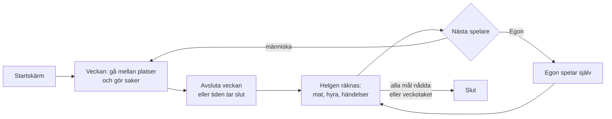

# Ekorrhjulet

Ett livsspel i webbläsaren, inspirerat av Sierras *Jones in the Fast Lane* (1991). Det ligger på [stefaneklund.se/ekorrhjulet](https://stefaneklund.se/ekorrhjulet). 1–4 spelare turas om vid samma enhet, och datorspelaren Egon kan vara med. Varje tur är en vecka med 60 timmar att fördela mellan jobb, plugg, mat, vila och nöje. Först att nå alla fem målen vinner.

> **Håll den här filen aktuell.** Den beskriver hur spelet fungerar *nu*. Ändras regler, sidor eller datamodell ska filen uppdateras i samma commit (se `AGENTS.md` i repots rot). Exakta fält och typer finns i [`_lib/types.ts`](_lib/types.ts), och alla siffror (priser, löner, krav) finns i [`_lib/data.ts`](_lib/data.ts). Den här filen förklarar hur det hänger ihop.

Hela spelidén, inklusive det som inte är byggt än, finns i speldokumentet på claude.ai (*Ekorrhjulet – speldokument*).

---

## Sidor och filer

| Adress | Fil |
|---|---|
| `/ekorrhjulet` | `page.tsx` → `_components/game.tsx` |

Spelet har en **egen root-layout** (`layout.tsx`, `ekorrhjulet.css`) och påverkas inte av huvudsajtens stil. Det finns ingen server-del: allt körs i webbläsaren och sparas där.

| Fil | Vad den gör |
|---|---|
| `_lib/engine.ts` | Alla regler. Rena funktioner: `newGame`, `moveTo`, `actionsAt`, `perform`, `endTurn` samt mätarna (`trygghet`, `status`, `utveckling`, `lycka`, `progress`). |
| `_lib/ai.ts` | Datorspelaren Egon. |
| `_lib/data.ts` | Platser, jobb, kurser, prylar, priser, helgtexter och Egons repliker, per tidsepok. |
| `_lib/rng.ts` | Slumpgenerator med frö. Slumpens tillstånd sparas i spelet, så samma frö ger samma händelser. |
| `_lib/save.ts` | Sparning i webbläsaren (`localStorage`): pågående spel, ljudval och Bästa liv. |
| `_lib/tips.ts` | Birgittas råd: väljer det viktigaste tipset för spelaren just nu. |
| `_components/birgitta.tsx` | Birgittas pixelporträtt (16 × 16). |
| `_lib/sound.ts` | Ljudeffekter och musik, genererade med Web Audio. Inga ljudfiler. |
| `_components/game.tsx` | Skärmarna och spelflödet. |
| `_components/start.tsx` | Titelskärmen i arkadstil: meny, Bästa liv, Hur man spelar och inställningarna för ett nytt spel. |
| `_components/board.tsx` | Kartan: klickytor över byggnaderna, spelpjäser som går längs ringvägen och mittpanelen. |
| `_components/boards.ts` | Kartornas grafik (SVG), genererad från designytan: Småstaden = A2, Pixelstaden = B2. I Pixelstaden har delar som ska röra sig fått klasser `amb-*`, och de parkerade bilarna är borttagna. |
| `_components/panels.tsx` | Sidopanelen, platsfönstret, veckosammanfattningen och slutrutan. |

## Spelflöde

- **Titelskärm:** en arkadskärm i 1994-stil med stjärnhimmel, den animerade ekorren (`public/ekorrhjulet/ekorre.gif`), ett blinkande *TRYCK START* och en meny: *Nytt liv*, *Fortsätt (vecka X)* om det finns ett sparat spel, *Hur man spelar*, *Musik* och *Ljud*. Menyn går att styra med piltangenterna. Under menyn visas **Bästa liv**: de fem snabbaste vinsterna av människor i den här webbläsaren (vinst genom att nå alla mål, inte genom veckotaket). Längst ner syns Pixelstaden (`public/ekorrhjulet/pixelstaden.png`).
- **Nytt liv:** tidsepok (1994 eller nutid), spelare (1–4 plus Egon av/lätt/svår) och spellängd (Kort, Mellan, Lång). Under *Avancerat* finns svårighet, veckotak, startkapital och slumpfrö. **Spelplanen är alltid Pixelstaden i första versionen.** Småstaden, och stadsvalen *Full* (20 platser) och *Anpassad*, syns utgråade som "kommer snart". Koden för Småstaden finns kvar, och ett gammalt sparat Småstaden-spel går fortfarande att fortsätta.
- **Spelarrutan** högst upp till höger visar namn, jobb och timlön samt var man jobbar (*Jobbar på Kvickköp*) (eller *Arbetssökande*). Toppraden visar veckan, när hyran dras nästa gång (röd när den dras i helgen) och vems tur det är.
- **Skärmen på datorn** är exakt lika hög som fönstret och skrollar aldrig: kartan blir så stor som får plats på höjden och bredden, och sidopanelen är kompakt (blir skärmen lägre än cirka 750 pixlar skrollar bara panelen). I Pixelstaden ligger knappen *Avsluta veckan* i Birgittas ruta i parken, se *Birgitta* nedan. På mobilen staplas kartan och panelen under varandra.
- **Veckan:** spelaren klickar på en byggnad. Pjäsen går dit längs vägen (restiden dras), och platsens fönster öppnas med allt man kan göra där. Varje knapp visar tid, pris och effekt, och det som inte går visar varför. Platsfönstret är brett med knapparna i ett rutnät och skrollar inte; *Gå ut på gatan* syns alltid. Kurser och prylar visas som ett kort med två val: *Betala* eller *CSN-lån*, *Köp* eller *Avbetala*.
- **När timmarna tar slut** (mindre än en halvtimme kvar) går spelet automatiskt till helgen efter en kort paus. Man kan också avsluta veckan tidigare själv.
- **Helgen:** en sammanfattning per spelare med lön, utgifter, helgaktivitet, veckans händelse och ställningen.

## Regler i korthet

- **Tid:** 60 timmar per vecka (måndag–fredag 08–20). Ett steg längs ringen tar 0,5 h, och man går alltid den kortaste vägen. Cykel sparar 25 %. Hälsa under 25 gör att allt tar 25 % längre tid. Jobbtorget stänger 17, puben öppnar 16.
- **Behovstrappan:** fem mätare enligt Maslow: Hälsa, Trygghet, Relationer, Status och Utveckling. Hälsa och Relationer ändras direkt av det man gör. Trygghet, Status och Utveckling räknas fram ur boende, buffert, jobb, kläder, prylar och examina.
- **Lycka** = 30 % Hälsa + 25 % Trygghet + 20 % Relationer + 15 % Status + 10 % Utveckling, plus trivsel från prylar och partner. Är en nivå under 40 räknas alla nivåer ovanför till hälften.
- **Mål:** pengar (nettoförmögenhet), antal examina, karriärnivå (1–9), Relationer och Lycka. Alla fem på 100 % vinner. Med veckotak vinner den med högst snitt när taket nås.
- **Jobb:** nio nivåer. Kraven är examina, veckors erfarenhet, kläder och pålitlighet. Att söka tar 1 h och lyckas oftast. Lönen betalas direkt per pass. Den som inte går till jobbet en hel vecka tappar pålitlighet och kan få sparken.
- **Boende:** man börjar i en dyr andrahandsetta. Bostadskön ger 1 poäng per vecka, och 30 poäng ger hyresrätt med låst hyra. Bostadsrätt kräver insats på banken och jobb på nivå 4. Hyran dras var fjärde vecka. Obetalt går till inkasso (hälften av lönen går dit tills skulden är betald). Två missade hyror betyder vräkning till en kompis soffa.
- **Ekonomi:** kontanter, bank (sparränta), indexfond, teknikaktier (kan krascha), privatlån, CSN och avbetalning. 1994 har högre räntor och priser på cirka 60 % av nutidens.
- **Elakheter:** Långfingrade Leffe snor kontanter utanför banken och prylar ur andrahandslägenheter (hemförsäkring skyddar). Svält, utbrändhet, sjukdom, uppbrott, varsel under kris och hyreshöjningar finns också. Svårigheten ändrar sannolikheterna (Snäll ×0,5, Elak ×1,5).
- **Helgen:** kontanter i fickan äts av en slumpad helgaktivitet. Pengar på banken är säkra.

## Liv i staden

Pixelstaden rör sig lite hela tiden, men lugnt och i små steg så att det inte stör (`Ambient` i `_components/board.tsx` och avsnittet *Life in Pixelstaden* i `ekorrhjulet.css`):

- **Trafik:** en röd bil kör medurs i inre filen och bussen moturs i yttre filen.
- **Natur:** ankan simmar fram och tillbaka i dammen, två fåglar flyger förbi ibland, en fjäril fladdrar vid blommorna, blommorna glimmar, dammen skimrar, träden vajar och molnskuggor glider över staden.
- **Husen:** utropstecknet på Jobbtorget studsar, ekollonet på banken gungar, hanteln på Gymmet lyfts, pubskylten svänger, tv:n på Prylpalatset blinkar, pubens fönster lyser varmt och lampor tänds och släcks i Lägenheten och på Bostadsbolaget.
- **De som väntar på sin tur** (till exempel Egon) är små ekorrar som strövar medurs längs trottoaren runt staden. Den som spelar står på vägen som vanligt.

Har datorn inställningen *minska rörelse* (`prefers-reduced-motion`) stängs allt detta av.

## Birgitta

Birgitta från Jobbtorget sitter i rutan i parken med sitt porträtt, klockan och ett råd. Hon tittar på spelarens läge och säger det viktigaste just nu, i prioritetsordning (se `_lib/tips.ts`):

1. **Akut** (gul text med utropstecken): helt slut i kroppen (sov), tomt kylskåp, vräkt, hyran går inte ihop, inkasso, låg hälsa, inte varit på jobbet.
2. **Nybörjarhjälp:** välkomsttext första veckan, sök jobb, gå till ditt första jobb.
3. **Inför helgen:** sätt in kontanter, hemförsäkring, slitna kläder, ensamhet.
4. **Långsiktigt:** bostadskön, nästa utbildning, plugga på den kurs man läser, gym.

Resultatet av det man gör (lön, inbrott och så vidare) visas som korta meddelanden längst ner på kartan. Under Egons tur visas Egon i rutan.

## Egon

Egon följer en prioritetslista: mat, hälsa, boende, bättre jobb, kläder, bostadskö, jobb, relationer, plugg och sist möbler. Det sista är hans svaghet. *Lätt* går till puben ibland i stället, *Svår* sparar på banken. Han spelar sin vecka direkt och visas i sammanfattningen med en replik.

## Sparning och ljud

- Spelet sparas automatiskt i webbläsaren efter varje drag (en sparning åt gången). *Fortsätt sparat spel* visas på startskärmen. Ett avslutat spel raderas.
- Under **kugghjulet** längst upp till höger finns *Musik*, *Ljud* och *Nytt spel* (`_components/settings-menu.tsx`). *Nytt spel* frågar en gång till innan det pågående spelet avslutas och raderas. Ljudvalen sparas, och samma val finns i titelskärmens meny. Musiken startar först efter ett klick, eftersom webbläsare blockerar ljud som spelas automatiskt.

## Inte byggt än

Småstaden som valbar spelplan, full stad med 20 platser och anpassad stad, Vårdcentralen och de andra nio nya platserna, egen musik per plats och riktiga musikspår för Småstaden.
