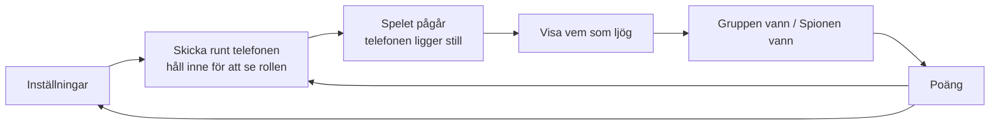

# Vem ljuger?

Ett sällskapsspel för 3–12 personer på [stefaneklund.se/vemljuger](https://stefaneklund.se/vemljuger). Alla utom spionen får samma hemliga ord. Man turas om att säga något om ordet och försöker sedan peka ut den som ljuger.

Spelet körs på **en telefon** som skickas runt när rollerna delas ut. Sedan behövs telefonen inte förrän man vill se svaret. Det finns inga konton och ingen server. Allt sker i webbläsaren, och spelet går att installera som app (PWA) och spela offline.

> **Håll den här filen aktuell.** Den beskriver hur spelet fungerar *nu*. Ändras flödet, reglerna, ordlistan eller datamodellen ska filen uppdateras i samma commit (se `AGENTS.md` i repots rot). Exakta fält och typer finns i [`_lib/types.ts`](_lib/types.ts).

---

## Flöde



1. **Inställningar** (en enda skärm, allt har ett standardval så att man kan trycka *Starta* direkt):
   - **Spelare:** 3–12. Namn är frivilliga. Utan namn heter de *Spelare 1, 2, 3 …*
   - **Kategori:** *Slumpa* (alla kategorier) eller en eller flera valda. Med flera valda slumpas en av dem.
   - **Spioner:** 1, 2, 3 eller *Slumpa*, se *Antal spioner* nedan.
   - **Läge:** *Klassiskt* eller *Fel ord*, se *Lägen* nedan. I det klassiska läget kan ledtråden till spionen stängas av.
2. **Skicka runt telefonen:** skärmen visar vems tur det är. Spelaren **håller inne** rutan för att se sin roll, och rollen döljs så fort man släpper. Knappen *Klar* går först att trycka på när man har tittat.
3. **Spelet pågår:** skärmen visar kategorin, vem som börjar (slumpas) och hur många spioner det finns. Därefter kan telefonen ligga kvar på bordet.
4. **Visa vem som ljög:** kräver två tryck så att ingen råkar avslöja svaret. Skärmen visar ordet, spionerna och spionernas ledtråd eller ord.
5. **Hur gick det?** *Gruppen vann* eller *Spionen vann*. Resultatet läggs till på poängtavlan.
6. **Poäng:** ställningen Gruppen–Spionen och en lista över rundorna. Därifrån startar man en ny runda med samma inställningar eller går tillbaka till inställningarna.

Rundan kan avbrytas när som helst med **[x]** uppe till höger (två tryck).

## Lägen

- **Klassiskt:** spionen vet att hen är spion och ser **kategorin** och, om det är påslaget, **en ledtråd**. Ledtråden är en av de ledtrådar som står vid ordet i ordlistan, alltså något en vanlig spelare kunde ha sagt. Är det flera spioner får de olika ledtrådar så långt det räcker. Åker spionen fast får hen gissa ordet, och gissar hen rätt vinner spionen ändå.
- **Fel ord:** spionen får ett **liknande ord** (*Kanelbulle* blir *Kardemummabulle*) och vet inte själv att hen är spionen. Alla ser texten *"Någon har ett annat ord. Kanske du?"*.

## Antal spioner

Hur många spioner som är tillåtet beror på antalet spelare (`maxSpies()` i [`_lib/game.ts`](_lib/game.ts)):

| Spelare | Högst | *Slumpa* ger |
|---|---|---|
| 3–5 | 1 | alltid 1 |
| 6–8 | 2 | 1 (65 %) eller 2 (35 %) |
| 9–12 | 3 | 1 (45 %), 2 (35 %) eller 3 (20 %) |

Med *Slumpa* visas antalet som **Hemligt** under spelet. Minskar man antalet spelare sänks ett fast spionantal automatiskt.

Allt slumpas med `crypto.getRandomValues`, så det är jämnt fördelat: vem som är spion, vem som börjar, kategori, ord och ledtråd.

## Ordlistan

Alla ord finns i [`_lib/words.ts`](_lib/words.ts), i elva kategorier med drygt 20 ord var. Varje rad ser ut så här:

```ts
w('Kanelbulle', 'Kardemummabulle', 'Fika', 'Ugn', 'Pärlsocker', 'Oktober'),
//  ordet        liknande ord       ledtrådar (3–5 st)
```

- **Liknande ord** används i läget *Fel ord*. Det ska vara nära men inte samma sak, gärna från samma kategori.
- **Ledtrådar** används i det klassiska läget. En bra ledtråd är något en vanlig spelare kunde säga i sin tur: den hjälper spionen att smälta in men avslöjar inte ordet. *Fika* är bra för *Kanelbulle*, *Kardemumma och kanel* är för avslöjande och *Mat* är för vag. Ledtråden får inte vara det liknande ordet.
- **Ny kategori:** lägg till ett block i `CATEGORIES` med ett nytt `id`. Ändra aldrig `id` på en befintlig kategori, eftersom det används i sparade inställningar.
- Samma ord kommer inte igen på samma telefon förrän alla ord i kategorin har spelats.

## Vad som sparas

Allt sparas bara i telefonens webbläsare (`localStorage`, nyckeln `vl:v1`), aldrig på servern: inställningar och namn, pågående runda, poängtavla och vilka ord som har spelats. Därför kan man ladda om sidan eller låsa telefonen mitt i en runda utan att något försvinner. *Nollställ poängen* rensar poängtavlan men behåller inställningarna. I privat läge eller med blockerad lagring fungerar spelet ändå, men inget sparas.

## App och offline (PWA)

- **Manifest:** [`public/vemljuger/manifest.webmanifest`](../../public/vemljuger/manifest.webmanifest) med namn, färger och ikoner (192 och 512 px, plus en "maskable" för Android). Det kopplas in i `layout.tsx`.
- **Service worker:** [`public/vemljuger/sw.js`](../../public/vemljuger/sw.js) gäller bara `/vemljuger`. Sidan hämtas från nätet när det finns och annars från cachen. Skript, typsnitt och ikoner cachas första gången de hämtas. Eftersom filen ligger i `/vemljuger/` men ska styra sidan `/vemljuger` skickas headern `Service-Worker-Allowed` från `next.config.ts`.
- **Installera:** på Android visas knappen *Installera som app* längst ner på inställningsskärmen (Chromes `beforeinstallprompt`). På iPhone visas i stället en instruktion: Dela, sedan *Lägg till på hemskärmen*. Är appen redan installerad visas ingenting.
- **Ny version:** när sidan ändras hämtar telefonen den nya versionen nästa gång den är online. Byt `CACHE` (i både `sw.js` och `_components/install.tsx`) om de gamla cachade filerna ska rensas.
- Service workern registreras bara i produktion, inte med `npm run dev`.

## Statistik

Två räknare syns på [adminsidan](../admin/README.md): **besök** (`view_landing`) och **spelade rundor** (`round`, en per *Starta* eller *Ny runda*). Båda skickas via `/api/hit` och sparas utan någon information om spelarna. Offline räknas ingenting.

## Kodens delar

| Fil | Ansvar |
|---|---|
| `page.tsx`, `layout.tsx` | Sidan, egen root-layout (grön terminalstil), metadata för appen |
| `_components/game.tsx` | Alla skärmar: inställningar, skicka runt, spelet pågår, avslöja, poäng |
| `_components/install.tsx` | Registrerar service workern och visar *Installera som app* |
| `_lib/game.ts` | Spellogik: dela ut en runda, antal spioner, slump, spara/läsa |
| `_lib/words.ts` | Kategorier, ord, liknande ord och ledtrådar |
| `_lib/types.ts` | Datamodellen |
| `vemljuger.css` | Utseendet |
