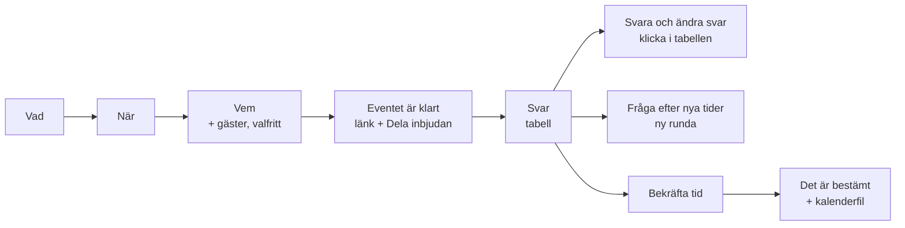
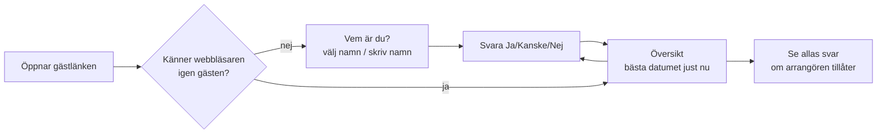

# Whenworks

Ett verktyg för att hitta en tid som passar en grupp. Det ligger på [stefaneklund.se/whenworks](https://stefaneklund.se/whenworks).

Arrangören skapar ett event och får två länkar: en **gästlänk** att dela och en privat **arrangörslänk**. Gästerna svarar Ja, Kanske eller Nej per tid. Arrangören ser svaren, kan fråga efter nya tider i nya rundor och bekräftar till sist en tid. Det finns inga konton, och event raderas automatiskt efter 60 dagar.

> **Håll den här filen aktuell.** Den beskriver hur appen fungerar *nu*. Ändras beteendet, datamodellen eller reglerna ska filen uppdateras i samma commit (se `AGENTS.md` i repots rot). Exakta fältnamn och typer finns i koden, i [`_lib/types.ts`](_lib/types.ts), som är den riktiga sanningen. Den här filen förklarar *varför* och *hur det hänger ihop*.

Se även [`COMPETITORS.md`](COMPETITORS.md), en konkurrentanalys (ögonblicksbild med datum) och förslag på vad som bör byggas härnäst.

---

## Sidor

| Adress | Vem | Fil |
|---|---|---|
| `/whenworks` | Arrangören skapar ett event | `page.tsx` → `_components/create.tsx` |
| `/whenworks/e/[slug]` | Gästlänken | `e/[slug]/page.tsx` → `_components/guest.tsx` |
| `/whenworks/e/[slug]/admin/[token]` | Arrangörslänken | `e/[slug]/admin/[token]/page.tsx` → `_components/organizer.tsx` |

`slug` är eventets korta kod (8 tecken, t.ex. `kqrv6xHA`). `token` är arrangörens hemliga nyckel (22 tecken, 128 bitar).

Whenworks har en **egen root-layout** (`layout.tsx`, `whenworks.css`). Därför påverkas den inte av huvudsajtens gröna terminalstil, som ligger i `app/(site)/`.

## Flöden

### Arrangören

Målet är att det ska vara **skitenkelt**: tre steg och så få val som möjligt. Det som tidigare var inställningar är nu fasta regler (se *Fasta regler* nedan).

- **Vad:** titel, beskrivning och togglen *"Pågår flera dagar"*. Är den på anger arrangören antal dagar, och då väljs bara startdagar. Varje förslag täcker så många dagar (t.ex. "17–18 okt"). Se `spanOf()` i `_lib/logic.ts`. Annars är det vanliga tider med klockslag, utan angiven längd.
- **När:** antingen *föreslår arrangören tider*, eller så *låter hen gästerna föreslå*: ett datumintervall där gästerna markerar dagar. Klockslag väljs i **kvartar** (00, 15, 30, 45) med `TimeSelect` i `_components/ui.tsx`.
- **Vem:** arrangörens namn. Under den hopfällda *"Lägg till vilka som ska med"* kan hen lista gäster (namn och eventuellt mejl), så att gästerna väljer sitt namn i en lista. Här finns också togglen *"Deltagarna kan se varandras svar"*.
- **Eventet är klart:** gästlänken med *Kopiera*, och knappen **Dela inbjudan**. På mobilen öppnar den telefonens delningsmeny (WhatsApp, Messenger, sms …) med ett färdigt meddelande. Där delning saknas kopieras meddelandet i stället. Under den finns den privata arrangörslänken.
- **Arrangören är också deltagare.** Tider hen själv föreslår markeras automatiskt som Ja. Övriga tider svarar hen på genom att klicka på sin egen rad i tabellen. En ruta påminner om det tills allt är besvarat.
- **Ändra svar:** arrangören kan klicka direkt i tabellen och ändra **vem som helsts** svar, även sina egna. Det är praktiskt vid långa datumserier eller när någon har svarat via sms. Varje klick stegar Ja → Kanske → Nej → tomt och sparas direkt. Raderna behåller sin ordning.

### Gästen

- **Finns en gästlista** väljer gästen sitt namn i en rullgardinsmeny, eller väljer *"Jag står inte med"* och skriver sitt namn. Finns ingen lista skriver gästen sitt namn.
- **Den personliga länken** ligger hopfälld längst ner på översikten (*"Ändra dina svar på en annan enhet?"*), eftersom de flesta inte behöver den.
- **Efter första svaret** känns gästen igen (se *Identitet* nedan) och hamnar direkt på översikten.
- *"Se allas svar"* visas bara om arrangören har slagit på *"Deltagarna kan se varandras svar"*.

## Datamodell

Data sparas i **Redis** (Upstash), som är en nyckel–värde-databas. Varje event består av **tre nycklar** som alla har eventets `slug` i namnet:

| Nyckel | Innehåll | Skrivs av |
|---|---|---|
| `ww:ev:{slug}` | **Eventet**: ett dokument med allt arrangören bestämt (typ `EventDoc`) | arrangören |
| `ww:sg:{slug}` | **Gästernas förslag** på nya tider: en lista, en post per tid (typ `Slot`) | gäster |
| `ww:rs:{slug}` | **Svaren**: en lista med en post per person, där namnet i gemener är nyckeln (typ `StoredResponse`) | gäster och arrangören |

Varför tre nycklar och inte en? Gästernas svar och förslag skrivs **var för sig**, så två gäster som svarar samtidigt kan inte skriva över varandra. Eventdokumentet ändras bara av arrangören.

### Fasta regler

De här var tidigare val, men är nu alltid på för att hålla det enkelt:
- **Alla måste kunna** (`mustAll`). Arrangören ser vilka som saknas och kan fråga efter nya tider i en ny runda.
- **Gästerna kan föreslå tider** (`allowSuggest`), även i senare rundor.
- **Vem som helst med länken kan lägga till sig**, även när det finns en gästlista.
- Det finns ingen *"Svara senast"*.

### Språk

Svenska eller engelska. Ett sparat val (`localStorage`) gäller först, annars följer sidan webbläsarens språk: svenska för `sv`, annars engelska. Växlingen är en liten länk i sidfoten.

### Eventet (`EventDoc`)
- **Innehåll:** titel, beskrivning, längd (`dur` + `durUnit`: timmar/dagar), läge (`fixed` = arrangören föreslår, `open` = gästerna markerar dagar i `range`).
- **Tider:** `slots` innehåller arrangörens förslag från alla rundor. `removed` innehåller id:n på tider som tagits bort i en ny runda. De **göms** men raderas inte, så svaren finns kvar.
- **Inställningar:** `showOthers`. `mustAll` och `allowSuggest` sparas alltid som `true` (se *Fasta regler*). `deadline` finns bara kvar i äldre event och visas inte.
- **Gästlistan:** `invitees` (namn och valfritt mejl).
- **Rundor:** `round` och `roundNote`.
- **Slutlig tid:** `finalSlotId` och `finalNote`.
- **Säkerhet:** `adminHash`, ett fingeravtryck av arrangörens nyckel (se nedan).
- **Livslängd:** `createdAt` och `expiresAt`.

Fält som lagts till efter att appen gick live (t.ex. `invitees`) är **valfria** i typen, eftersom äldre event saknar dem. Koden använder i så fall ett standardvärde.

### En tid (`Slot`)
`{ id, date, time, round, by? }`
- `time: null` betyder heldag. I flerdagarsevent räknas slutdagen ut från längden och sparas inte.
- `id` består av datum och tid, med prefix för var tiden kommer ifrån: inget prefix för arrangörens första runda, `r2_…` för senare rundor och `x_…` för gästförslag. I läget "gästerna markerar dagar" är id:t bara datumet.
- `by` = namnet på gästen som föreslog tiden.

### Ett svar (`StoredResponse`)
`{ name, email, answers, tokenHash?, updatedAt }`
- `answers` kopplar tidens id till `yes`, `maybe` eller `no`.
- Namnet (i gemener) är nyckeln, så samma person **ersätter** sitt svar och får ingen dubblett.
- Arrangörens egna svar ligger här också, under hens namn.
- `tokenHash` låser namnet till gästens webbläsare (se *Identitet*).

### Det som räknas ut, och aldrig sparas
Bästa datum, "Alla kan" / "Närmast", vilka som saknas och vilka inbjudna som inte svarat räknas fram vid varje sidvisning, i `_lib/logic.ts` (`findBest`, `tally`, `missingOf`) och `_lib/server.ts`. Poäng: **Ja = 2, Kanske = 1**. Vid lika poäng vinner den tidigaste tiden.

### Radering
Alla tre nycklarna får ett utgångsdatum (TTL), 60 dagar efter att eventet skapades. Redis raderar dem själv, så det behövs inget städjobb.

## Säkerhet och identitet

Det finns inga konton. Behörigheten bygger på **hemliga nycklar i länkar och cookies**. Databasen sparar bara deras **hash**, ett fingeravtryck som inte går att räkna tillbaka, så ingen kan återskapa länkarna även om de ser databasen.

| Vem | Hemligheten finns i | Databasen sparar | Ger rätt att |
|---|---|---|---|
| Arrangören | arrangörslänken (`/admin/[token]`) | `EventDoc.adminHash` | se allt, ändra eventet och **allas svar**, bekräfta tid |
| Gästen | cookien `ww_me_{slug}` och den personliga länken (`?me=…`) | `StoredResponse.tokenHash` | ändra *sina egna* svar |

**Gästidentitet:**
1. När gästen svarar första gången skapar servern en slumpad nyckel. Hashen sparas på gästens svar och nyckeln läggs i en cookie (`httpOnly`, gäller till eventet raderas).
2. Därefter är **namnet låst**. Svar med det namnet godtas bara från en webbläsare med rätt nyckel. Låsta namn kan inte väljas i namnlistan.
3. Översikten visar gästens **personliga länk** (`/whenworks/e/{slug}?me={nyckel}`). Öppnas den på en annan enhet sätts samma cookie där. Nyckeln tas sedan bort ur adressfältet.
4. *"Inte {namn}?"* raderar cookien i den webbläsaren.
5. Arrangören kan fortfarande ändra en låst gästs svar från arrangörssidan. Låset (`tokenHash`) ligger kvar, så gästen kan också fortsätta ändra själv.

**Regler som servern kontrollerar** (i `actions.ts`), inte bara gränssnittet:
- Gäster kan inte svara med arrangörens namn.
- Ett låst namn kan bara ändras med rätt nyckel.
- Är *"Deltagarna kan se varandras svar"* avstängt skickas andras svar aldrig till gästens webbläsare (`toGuestView` i `_lib/server.ts`).
- Mejladresser skickas aldrig till gäster, och arrangören ser bara om en gäst har lämnat en adress.

Svar som gavs innan namnlåsningen fanns saknar `tokenHash`. De låses första gången personen svarar igen.

## Kodens delar

| Fil | Ansvar |
|---|---|
| `_lib/types.ts` | Alla datatyper. **Sanningen** om vilka fält som finns. |
| `_lib/store.ts` | Läser och skriver de tre Redis-nycklarna. Har en minnesvariant för lokal utveckling. |
| `_lib/server.ts` | Laddar event, kontrollerar arrangörsnyckeln och bygger vyerna för gäst och arrangör (vad var och en får se). Skickar mejl. |
| `_lib/logic.ts` | Rena uträkningar: datumformat, flerdagsspann, poäng och bästa datum. Används både i webbläsaren och på servern. |
| `_lib/i18n.ts` | Alla texter på svenska och engelska. |
| `actions.ts` | Server actions, det enda sättet att ändra data: `createEvent`, `submitAnswers`, `getMyAnswers`, `openMyLink`, `forgetMe`, `getAdmin`, `setAnswerFor` (arrangören ändrar någons svar, även sitt eget), `askAgain`, `finalize`. |
| `_components/` | Skärmarna (`create`, `guest`, `organizer`) och delade delar (`ui`, `matrix` = svarstabellen, `answers` = Ja/Kanske/Nej-listan). |

## Konfiguration

| Miljövariabel | Behövs | Vad |
|---|---|---|
| `KV_REST_API_URL` + `KV_REST_API_TOKEN` (eller `UPSTASH_REDIS_REST_URL` + `UPSTASH_REDIS_REST_TOKEN`) | Ja, i produktion | Databasen. Sätts automatiskt när Upstash for Redis kopplas till Vercel-projektet. |
| `RESEND_API_KEY` + `WW_EMAIL_FROM` | Nej | Mejl via Resend. **Utan dessa döljs alla mejlfält** och inga mejl skickas. Fälten dyker upp av sig själva när variablerna finns (efter en redeploy). |
| `WW_MEMORY_STORE=1` | Bara för test | Använd minnesdatabasen även i ett produktionsbygge (`next start`). |

Lokalt räcker `npm run dev`. Utan databasvariabler används en minnesdatabas som töms när servern startas om.
